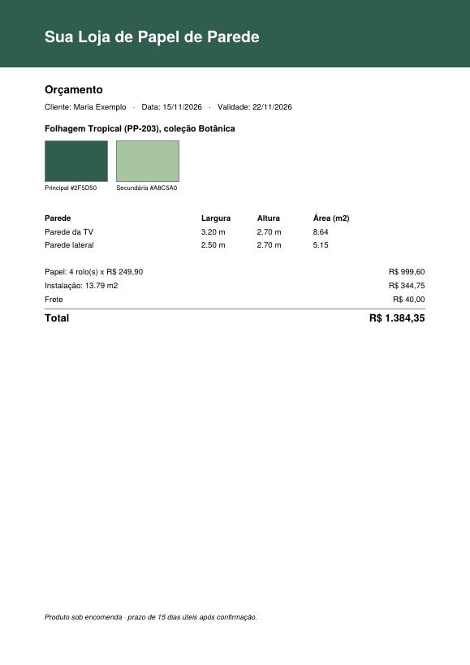

# 🧻 Orçamento automático de papel de parede

[](https://github.com/rafacampanha/orcamento-papel-de-parede/actions/workflows/testes.yml)

Ferramenta que transforma as **medidas das paredes** do cliente em um **orçamento completo**: calcula a quantidade de rolos (considerando o *rapport* da estampa), soma instalação e frete, gera um **PDF com a amostra de cores** do papel e uma **mensagem pronta para o WhatsApp**.

> Criada para o meu negócio de papel de parede (venda sob encomenda), para responder clientes em segundos em vez de fazer a conta na mão.



```text
Olá, Maria! Segue seu orçamento 😊

🧻 *Folhagem Tropical* (PP-203), coleção Botânica
📐 Área: 13.79 m² · *4 rolo(s)*
💰 Papel: R$ 999,60
🛠️ Instalação: R$ 344,75
🚚 Frete: R$ 40,00

*Total: R$ 1.384,35*
📦 Produto sob encomenda, prazo de 15 dias úteis.
```

## Como o cálculo funciona

1. Cada parede vira **faixas** de 53 cm: `faixas = ⌈largura / 0,53⌉`.
2. A altura de cada faixa ganha **10 cm de sobra** para corte e é arredondada para cima no múltiplo do **rapport** (para a estampa casar entre faixas).
3. `faixas por rolo = ⌊10 m / altura da faixa⌋` → `rolos = ⌈faixas / faixas por rolo⌉`.
4. Instalação é cobrada por m² (descontando portas/janelas informadas).

## Como usar

```bash
pip install -r requirements.txt
python -m orcamento.gerar exemplos/pedido.json   # gera saida/orcamento_maria.pdf e saida/mensagem_whatsapp.txt
pytest
```

- **Catálogo:** `exemplos/catalogo.csv` (código, nome, coleção, cores em hexadecimal, rapport, preço).
- **Pedido:** `exemplos/pedido.json` (cliente, papel escolhido, paredes, mão de obra e frete).

## Próximos passos

- Formulário web para o cliente informar as medidas.
- Envio automático pelo WhatsApp/Instagram via n8n.
- Simulação da estampa na foto do ambiente.

## Tecnologias

Python · ReportLab · CSV/JSON · pytest
